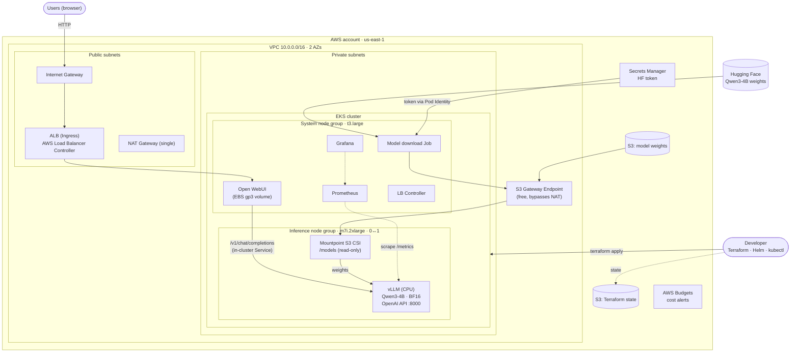

# Qwen3-4B on Amazon EKS with vLLM

Self-hosted, OpenAI-compatible LLM API and chat UI on Kubernetes: **Qwen3-4B-Instruct** served by **vLLM** on **Amazon EKS**, provisioned with **Terraform**, and monitored with **Prometheus + Grafana**.

> **Current phase: CPU inference.** The AWS account's GPU quota request is pending, so vLLM runs on an Intel `m7i.2xlarge` (AMX/AVX-512). The GPU path (`g6.xlarge`, NVIDIA L4) is already prepared for when the quota is approved.

---

## Architecture



### Request path
`Browser → ALB (Ingress) → Open WebUI (login) → vllm Service (ClusterIP) → vLLM pod → response`

vLLM itself is **never exposed to the internet**; users reach it only through Open WebUI's authentication.

### Model path
`Hugging Face → download Job (once) → S3 bucket → Mountpoint S3 CSI → /models in the vLLM pod → RAM`

The bucket lives in a separate Terraform stack, so the 7.5 GB model survives `terraform destroy`.

---

## Components

| Layer | Technology | Notes |
|---|---|---|
| Infrastructure as Code | Terraform (2 stacks, S3 backend with native locking) | `persistent` (bucket, secret, budget) and `dev` (VPC, EKS, IAM) |
| Network | VPC module, 2 AZs, single NAT, S3 Gateway Endpoint | model traffic skips NAT data charges |
| Kubernetes | Amazon EKS, 2 managed node groups | `system` (t3.large, always on), `inference` (m7i.2xlarge, scaled 0↔1) |
| Identity | EKS Pod Identity + IRSA | least-privilege roles per workload; no keys in pods |
| Model storage | S3 + Mountpoint for Amazon S3 CSI driver | static `ReadOnlyMany` volume |
| Serving | vLLM 0.29 (CPU build) | OpenAI-compatible API, API key, tool calling (`hermes` parser) |
| UI | Open WebUI | public via ALB Ingress, sign-ups need admin approval |
| Load balancing | AWS Load Balancer Controller | Ingress → ALB, 300 s idle timeout for streaming |
| Observability | kube-prometheus-stack + vLLM Grafana dashboard | TTFT, ITL, tokens/s, queue, KV cache |
| Cost control | AWS Budgets, scale-to-zero, destroy after each session | |

---

## Repository structure

```
.
├── terraform/
│   ├── persistent/     # model bucket, HF token secret, budget
│   └── envs/dev/       # VPC, EKS, node groups, add-ons, IAM, LB controller role
├── k8s/
│   ├── base/           # namespace, gp3 StorageClass, S3 PV/PVC
│   ├── model-job/      # Hugging Face → S3 downloader
│   ├── vllm/           # vLLM Deployment + Service (CPU; GPU version kept for later)
│   ├── openwebui/      # Open WebUI + ALB Ingress
│   ├── monitoring/     # Helm values, ServiceMonitor, Grafana dashboard
│   └── gpu/            # NVIDIA device plugin values (GPU phase)
└── RUNBOOK.md          # every command, step by step
```

---

## Key design decisions

- **Two Terraform stacks.** Long-lived data (model, secret, budget) is separated from the per-session environment, so `destroy` never deletes the model.
- **Weights in S3, mounted with Mountpoint.** One download from Hugging Face, then every new pod reads from S3. The S3 Gateway Endpoint keeps that traffic off the NAT.
- **Scale-to-zero inference node.** The expensive node runs only during a session; the cluster itself is destroyed after use.
- **vLLM stays internal.** Only Open WebUI is public; the API key and in-cluster Service protect the model endpoint.
- **Pod-level identity.** The downloader can write to the bucket and read one secret; the S3 driver can only read; nothing else gets AWS permissions.

---

## Results (CPU phase, `m7i.2xlarge`)

| Metric | Value |
|---|---|
| Model | Qwen3-4B-Instruct-2507, BF16, 7.49 GiB |
| Weight read from S3, default mmap | ~7.3 min per 3.7 GB shard (startup probe killed it at 15 min) |
| Weight read from S3, `--safetensors-load-strategy=prefetch` | 155 s for all weights (~6× faster) |
| Full startup (pod start → API ready) | ~11.5 min |
| Generation speed, 1 user | ~3.6 tokens/s |
| Compute threads | 3 OpenMP threads (4 physical cores, 1 reserved) |

Multi-user benchmarks and the GPU comparison (`g6.xlarge`, NVIDIA L4): *in progress*.

---

## Problems solved along the way

| Problem | Cause | Fix |
|---|---|---|
| GPU node group stuck, then `VcpuLimitExceeded` | New AWS account: G-instance quota = 0, increase denied | Moved to CPU inference; appeal + Spot quota request; GPU manifests kept ready |
| vLLM restarted at 67% loading | Startup probe (15 min) shorter than load time from S3 | Probe raised to 30 min; enabled `prefetch` loading |
| Very slow weight loading | mmap random reads over FUSE → many small S3 requests | `--safetensors-load-strategy=prefetch` (sequential, 8 threads) |
| `Unknown vLLM environment variable: VLLM_SERVICE_*` | Kubernetes injects env vars for the Service named `vllm` | `enableServiceLinks: false` |
| Open WebUI: `"auto" tool choice requires --enable-auto-tool-choice` | Open WebUI sends `tool_choice: auto` | `--enable-auto-tool-choice --tool-call-parser=hermes` |
| PVC `namespaces "llm" not found` | `kubectl apply -f dir/` applies files alphabetically | Renamed to `00-namespace.yaml` |
| HF token not read in the Job | pip-installed `awscli` reads `AWS_DEFAULT_REGION`, not `AWS_REGION` | Set both; fail fast if the secret can't be read |

---

## Cost

| Item | Approx. per hour (us-east-1) |
|---|---|
| EKS control plane | $0.10 |
| t3.large (system) | $0.08 |
| NAT Gateway | $0.045 + data |
| ALB | ~$0.02 + LCU |
| m7i.2xlarge (inference, only when running) | ~$0.40 |
| **Total with inference running** | **~$0.65–0.70** |

Everything except the S3 bucket and the secret is destroyed after each session. AWS Budgets alerts at 50 / 80 / 100 % of $20.

---

## How to run

Full commands are in **[RUNBOOK.md](RUNBOOK.md)**. In short:

1. `terraform/persistent`: `terraform apply` once.
2. Store the Hugging Face token in Secrets Manager.
3. `terraform apply` in `terraform/envs/dev`, then the Helm and `kubectl` steps in the runbook.
4. Open the ALB URL, create the admin account, chat with `qwen3-4b`.
5. Ordered teardown at the end of the session: delete the Ingress and Open WebUI, then `terraform destroy`.

---

## Roadmap

- [ ] Benchmarks with `vllm bench serve` (1 / 4 / 8 concurrent users)
- [ ] GPU node group (`g6.xlarge`, L4) once the quota is approved; CPU vs GPU table
- [ ] Faster startup: initContainer copies weights to local disk before vLLM starts
- [ ] CI/CD with GitHub Actions (OIDC, no stored AWS keys)
- [ ] HTTPS with a domain + ACM certificate