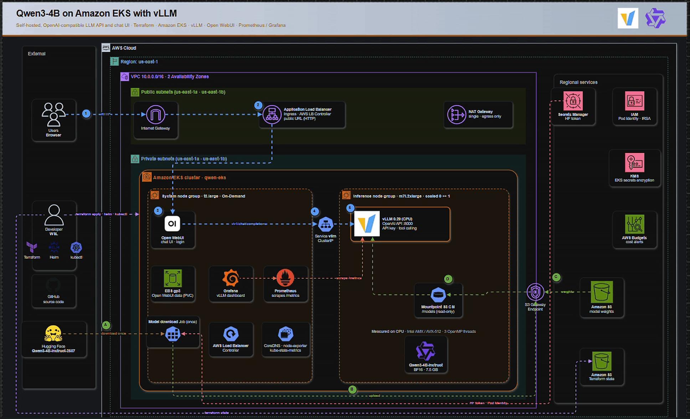
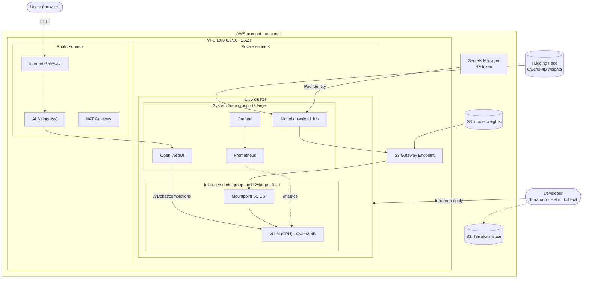

<div align="center">

# 🚀 Qwen3-4B on Amazon EKS with vLLM

**A self-hosted, OpenAI-compatible LLM API and chat UI on Kubernetes**
**Provisioned with Terraform · Served by vLLM · Monitored with Prometheus & Grafana**


[Architecture](#-architecture) •
[Highlights](#-highlights) •
[Results](#-results) •
[Components](#-components) •
[How to run](#-how-to-run) •
[Lessons learned](#-problems-solved-along-the-way) •
[Roadmap](#-roadmap)

</div>

---

> [!NOTE]
> **Current phase: CPU inference.** The AWS account's GPU quota request is pending, so vLLM runs on an Intel `m7i.2xlarge` (AMX / AVX-512).
> The GPU path (`g6.xlarge`, NVIDIA L4) is already prepared for when the quota is approved.

## 🏗️ Architecture

<p align="center">
  
</p>

<p align="center">
  <sub>Editable source: <a href="docs/qwen-eks-vllm-architecture.drawio"><code>docs/qwen-eks-vllm-architecture.drawio</code></a> (open in <a href="https://app.diagrams.net">draw.io</a>)</sub>
</p>

<table>
<tr>
<td width="50%" valign="top">

### 🔵 Request path
```
Browser
  → ALB (Ingress)
  → Open WebUI (login)
  → vllm Service (ClusterIP)
  → vLLM pod
  → response
```
vLLM is **never exposed to the internet**. Users reach it only through Open WebUI's authentication.

</td>
<td width="50%" valign="top">

### 🟢 Model path
```
Hugging Face
  → download Job (once)
  → S3 bucket
  → S3 Gateway Endpoint
  → Mountpoint S3 CSI (/models)
  → vLLM (RAM)
```
The bucket lives in a separate Terraform stack, so the **7.5 GB model survives `terraform destroy`**.

</td>
</tr>
</table>

<details>
<summary><b>📄 Text version of the diagram (Mermaid)</b></summary>



</details>

---

## ✨ Highlights

| | |
|---|---|
| 🧱 **Infrastructure as Code** | Two Terraform stacks with an S3 backend and native state locking |
| ☸️ **Production-style EKS** | Private subnets, two managed node groups, Pod Identity + IRSA, EBS & Mountpoint CSI add-ons |
| 🤖 **OpenAI-compatible API** | vLLM with API key auth and tool calling, behind an internal ClusterIP Service |
| 💬 **Public chat UI** | Open WebUI behind an ALB Ingress; new sign-ups need admin approval |
| 📦 **Model in S3, not in images** | Downloaded once, mounted read-only with Mountpoint; traffic bypasses the NAT |
| 📊 **Observability** | kube-prometheus-stack + the official vLLM Grafana dashboard (TTFT, ITL, tokens/s, KV cache) |
| 💰 **Cost-aware** | Inference node scales 0 ↔ 1, the cluster is destroyed after each session, AWS Budgets alerts |

---

## 📈 Results

<div align="center">

| 📦 Model size | ⚡ S3 prefetch | ⏱️ Full startup | 💵 Running cost |
|:---:|:---:|:---:|:---:|:---:|
| **7.5 GB** | **155 s** | **~11.5 min** | **~$0.70 / h** |
| Qwen3-4B, BF16 | all weights | pod start → API ready | 1 user, CPU | everything running |

</div>

| Metric | Value |
|---|---|
| Model | Qwen3-4B-Instruct-2507, BF16, 7.49 GiB |
| Weight read from S3, default mmap | ~7.3 min per 3.7 GB shard (startup probe killed it at 15 min) |
| Weight read from S3, `--safetensors-load-strategy=prefetch` | **155 s for all weights (~6× faster)** |
| Full startup (pod start → API ready) | ~11.5 min |
| Generation speed, 1 user | ~3.6 tokens/s |
| Compute threads | 3 OpenMP threads (4 physical cores, 1 reserved) |

---

## 🧩 Components

| Layer | Technology | Notes |
|---|---|---|
| Infrastructure as Code | Terraform (2 stacks, S3 backend with native locking) | `persistent` (bucket, secret, budget) and `dev` (VPC, EKS, IAM) |
| Network | VPC module, 2 AZs, single NAT, S3 Gateway Endpoint | model traffic skips NAT data charges |
| Kubernetes | Amazon EKS, 2 managed node groups | `system` (t3.large, always on), `inference` (m7i.2xlarge, scaled 0 ↔ 1) |
| Identity | EKS Pod Identity + IRSA | least-privilege roles per workload; no keys in pods |
| Model storage | S3 + Mountpoint for Amazon S3 CSI driver | static `ReadOnlyMany` volume |
| Serving | vLLM 0.29 (CPU build) | OpenAI-compatible API, API key, tool calling (`hermes` parser) |
| UI | Open WebUI | public via ALB Ingress, sign-ups need admin approval |
| Load balancing | AWS Load Balancer Controller | Ingress → ALB, 300 s idle timeout for streaming |
| Observability | kube-prometheus-stack + vLLM Grafana dashboard | TTFT, ITL, tokens/s, queue, KV cache |
| Cost control | AWS Budgets, scale-to-zero, destroy after each session | |

---

## 🧠 Key design decisions

- **Two Terraform stacks.** Long-lived data (model, secret, budget) is separated from the per-session environment, so `destroy` never deletes the model.
- **Weights in S3, mounted with Mountpoint.** One download from Hugging Face, then every new pod reads from S3. The S3 Gateway Endpoint keeps that traffic off the NAT.
- **Scale-to-zero inference node.** The expensive node runs only during a session; the cluster itself is destroyed after use.
- **vLLM stays internal.** Only Open WebUI is public; the API key and in-cluster Service protect the model endpoint.
- **Pod-level identity.** The downloader can write to the bucket and read one secret; the S3 driver can only read; nothing else gets AWS permissions.

---

## 📁 Repository structure

```
.
├── docs/
│   ├── qwen-eks-vllm-architecture.gif      # animated architecture diagram
│   └── qwen-eks-vllm-architecture.drawio   # editable source
├── terraform/
│   ├── persistent/     # model bucket, HF token secret, budget
│   └── envs/dev/       # VPC, EKS, node groups, add-ons, IAM, LB controller role
├── k8s/
│   ├── base/           # namespace, gp3 StorageClass, S3 PV/PVC
│   ├── model-job/      # Hugging Face → S3 downloader
│   ├── vllm/           # vLLM Deployment + Service (CPU; GPU version kept for later)
│   ├── openwebui/      # Open WebUI + ALB Ingress
│   ├── monitoring/     # Helm values, ServiceMonitor, Grafana dashboard
│   └── gpu/            # NVIDIA device plugin values (GPU phase)
└── RUNBOOK.md          # every command, step by step
```

---

## 🛠️ How to run

> Full commands are in **[RUNBOOK.md](RUNBOOK.md)**.

**Prerequisites:** AWS CLI, Terraform ≥ 1.10, kubectl, Helm, and an AWS account with an `m7i.2xlarge`-sized On-Demand Standard quota (≥ 10 vCPU).

```bash
# 1. Long-lived resources (once): model bucket, HF token secret, budget
cd terraform/persistent && terraform init && terraform apply

# 2. Store the Hugging Face token
aws secretsmanager put-secret-value --secret-id qwen-eks/hf-token --secret-string "$HF_TOKEN"

# 3. The environment: VPC + EKS (~15-20 min)
cd ../envs/dev && terraform init && terraform apply
aws eks update-kubeconfig --region us-east-1 --name qwen-eks

# 4. Kubernetes: LB controller, model, vLLM, Open WebUI, monitoring
#    → follow RUNBOOK.md steps 2-7
```

Then open the ALB URL, create the admin account and chat with **`qwen3-4b`**.

> [!WARNING]
> **Teardown order matters.** Delete the Ingress and Open WebUI first (they create the ALB and an EBS volume outside Terraform), then run `terraform destroy`.

---

## 🧯 Problems solved along the way

| Problem | Cause | Fix |
|---|---|---|
| GPU node group stuck, then `VcpuLimitExceeded` | New AWS account: G-instance quota = 0, increase denied | Moved to CPU inference; appeal + Spot quota request; GPU manifests kept ready |
| vLLM restarted at 67% loading | Startup probe (15 min) shorter than load time from S3 | Probe raised to 30 min; enabled `prefetch` loading |
| Very slow weight loading | mmap random reads over FUSE → many small S3 requests | `--safetensors-load-strategy=prefetch` (sequential, 8 threads) |
| `Unknown vLLM environment variable: VLLM_SERVICE_*` | Kubernetes injects env vars for the Service named `vllm` | `enableServiceLinks: false` |
| Open WebUI: `"auto" tool choice requires --enable-auto-tool-choice` | Open WebUI sends `tool_choice: auto` | `--enable-auto-tool-choice --tool-call-parser=hermes` |
| PVC `namespaces "llm" not found` | `kubectl apply -f dir/` applies files alphabetically | Renamed to `00-namespace.yaml` |
| HF token not read in the Job | pip-installed `awscli` reads `AWS_DEFAULT_REGION`, not `AWS_REGION` | Set both; fail fast if the secret can't be read |

---

## 💵 Cost

| Item | Approx. per hour (us-east-1) |
|---|---|
| EKS control plane | $0.10 |
| t3.large (system) | $0.08 |
| NAT Gateway | $0.045 + data |
| ALB | ~$0.02 + LCU |
| m7i.2xlarge (inference, only when running) | ~$0.40 |
| **Total with inference running** | **~$0.65–0.70** |

Everything except the S3 bucket and the secret is destroyed after each session. AWS Budgets alerts at 50 / 80 / 100 % of $20.

---

## 🗺️ Roadmap

- [x] Terraform: VPC, EKS, IAM, S3, Secrets Manager, Budgets
- [x] vLLM serving Qwen3-4B on CPU with S3-mounted weights
- [x] Open WebUI behind a public ALB
- [x] Prometheus + Grafana with the vLLM dashboard
- [ ] GPU node group (`g6.xlarge`, NVIDIA L4) once the quota is approved; CPU vs GPU table
- [ ] Faster startup: initContainer copies weights to local disk before vLLM starts
- [ ] HTTPS with a domain + ACM certificate

---

<div align="center">

**Built by [Mohammed Ahmed](https://github.com/mohammedelnageb)** · LLMOps & AI Infrastructure

⭐ If this project helped you, consider giving it a star!

</div>
